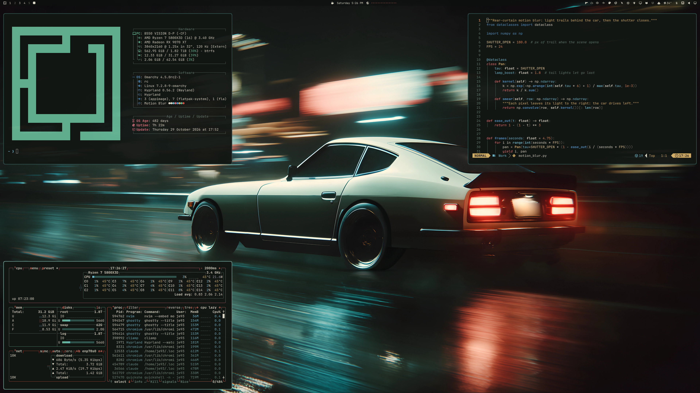
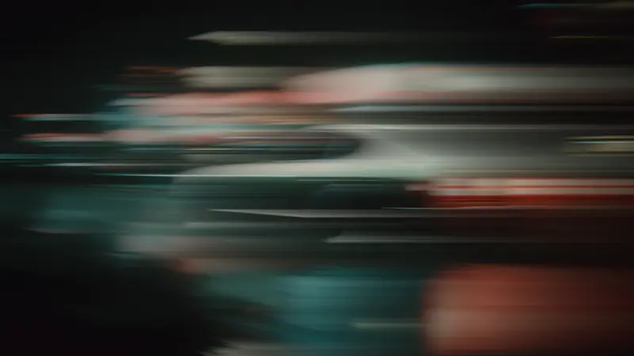

# Motion Blur

A white classic coupe streaking through rain-soaked neon: near-black night, wet-road teal and tail-light coral. A dark theme for Omarchy.



## Install

For **Omarchy 4 with Omarchy Shell**:

```sh
omarchy theme install https://github.com/erikrjohansson/omarchy-motion-blur-theme
```

## Update

```sh
omarchy theme update
```

## Remove

```sh
omarchy theme remove motion-blur
```

## The theme

- Windows, menus and notifications on one near-black night surface, with cream text and a tail-light coral accent.
- Terminal colors taken from the wallpaper: tail-light reds and oranges, street-light yellow and the teal of the wet road.
- Yaru folder icons.
- A boot screen in the theme's colors: pick it in the Omarchy menu under Appearance → Unlock.

## Wallpaper

One **6688 × 3764** wallpaper.

## Boot intro

The wallpaper has a short boot intro: the scene opens as one long motion-blur smear and pulls back into the still photo. It plays on Omarchy 4.5 and later. Click it for the full-resolution video.

<a href="backgrounds/intros/01-wedge.mp4"></a>

## License

[MIT](LICENSE) · [Omarchy artwork attribution](THIRD_PARTY_NOTICES.md)
